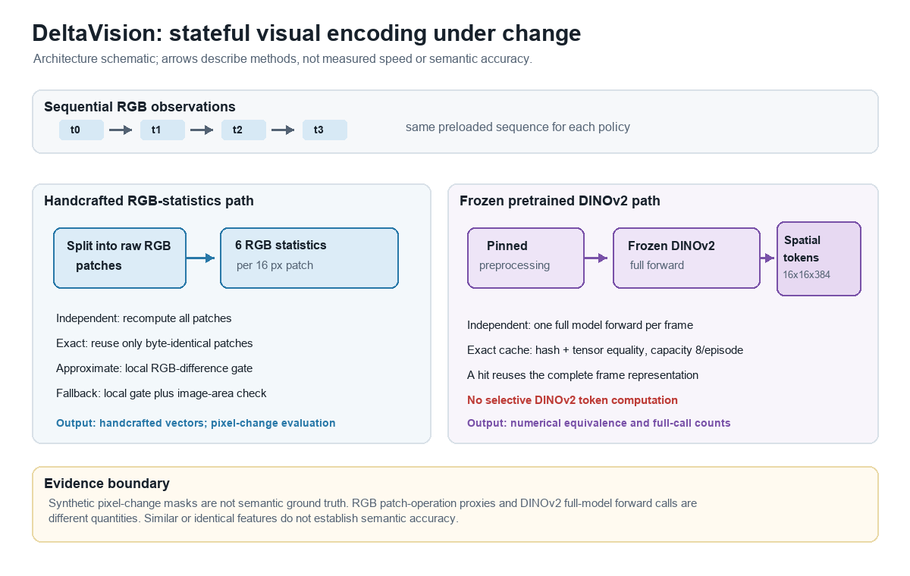
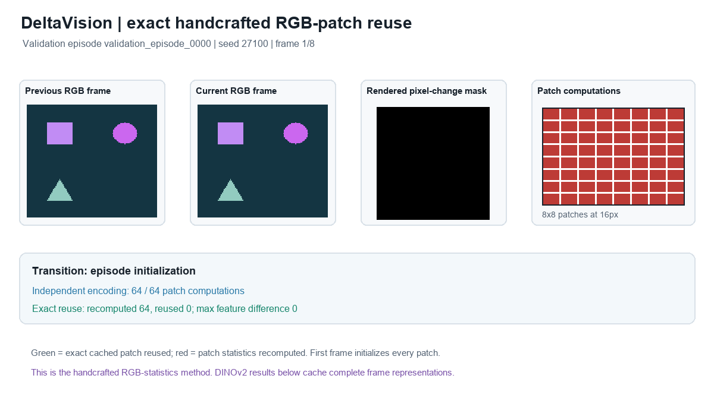

# DeltaVision: Stateful Visual Encoding Under Change

DeltaVision is an independent research software project studying when
sequential visual features can be reused without changing the output of an
independent encoder. The current study compares handcrafted RGB patch
policies with exact whole-frame caching of frozen DINOv2. It is not a
peer-reviewed publication.

## Research question

> When does visual-state reuse provide computational benefits without degrading representation correctness?

## Main findings

- On a **previously inspected synthetic held-out partition**, exact RGB patch
  reuse matched the independent handcrafted features, with F1 1.000 and 31.5%
  of the independent patch-operation count.
- Approximate RGB reuse at 0.01 had F1 0.997 and a 0.5% missed-change rate;
  the configured global fallback had F1 0.982 and a 3.5% missed-change rate.
- On synthetic DINOv2 validation workloads, exact whole-frame caching reduced
  full forwards when preprocessed inputs repeated. When every input changed,
  it avoided no forwards and measured slower than independent inference.
- These are controlled synthetic findings. RGB masks represent pixel
  differences, not semantic change, and feature equality does not demonstrate
  downstream accuracy.

## Visual overview



The handcrafted path reuses individual RGB patch vectors by exact byte
equality. The separate DINOv2 path reuses a complete spatial-token
representation only when the complete preprocessed image tensor matches.
Neither method makes a semantic accuracy claim.



The GIF shows an existing synthetic validation episode and a separate slide
of saved DINOv2 results. It computes the small handcrafted demonstration only;
it does not load weights or rerun the pretrained benchmark. See the
[failure gallery](docs/failure_gallery/index.md) for transformation-specific
examples.

## Quantitative results

### Handcrafted RGB statistics — previously inspected synthetic held-out data

Thirty episodes (240 frames, 210 transitions), 128×128 images, 16-pixel
patches. The held-out partition had been inspected in earlier experiments;
this was not a blind test. F1 intervals are 95% episode-cluster bootstrap
intervals.

| Method | Precision / recall | F1 (95% CI) | Missed changes | False refresh | Feature MAE | All-frame patch-operation fraction | Median seconds / 240 frames |
| --- | ---: | ---: | ---: | ---: | ---: | ---: | ---: |
| Independent RGB | 0.2168 / 1.0000 | 0.3564 (0.2899–0.4262) | 0.0000 | 1.0000 | 0 | 1.0000 | 1.295 |
| Exact patch reuse | 1.0000 / 1.0000 | 1.0000 (1.0000–1.0000) | 0.0000 | 0.0000 | 0 | 0.3147 | 0.439 |
| Approximate reuse, 0.01 | 1.0000 / 0.9949 | 0.9974 (0.9951–0.9992) | 0.0051 | 0.0000 | 0.0000194 | 0.3137 | 0.722 |
| Global fallback, local 0.05 / area 0.50 | 1.0000 / 0.9650 | 0.9822 (0.9709–0.9889) | 0.0350 | 0.0000 | 0.000586 | 0.3081 | 0.963 |

Transition metrics exclude episode initialization; feature MAE and operation
fractions include all frames. Patch-operation counts are handcrafted work
proxies, not neural FLOPs.

### Frozen DINOv2 — synthetic validation data

Four eight-frame episodes per condition; cache capacity 8 per episode. The
ratio is independent median latency divided by cached median latency. Values
below 1 indicate a measured slowdown. Feature outputs were 16×16×384 with
maximum and mean absolute difference 0 and cosine similarity 1.0.

| Condition | Independent / cached full forwards | Cache hits / rate | Median seconds, independent / cache | Measured ratio | Paired episode-bootstrap 95% CI* | Peak tensor payload |
| --- | ---: | ---: | ---: | ---: | ---: | ---: |
| Identical consecutive | 32 / 4 | 28 / 87.5% | 0.611 / 0.107 | 5.689× | 5.612–5.759 | 0.95 MiB |
| Sparse changes | 32 / 8 | 24 / 75.0% | 0.589 / 0.176 | 3.337× | 3.301–3.344 | 1.90 MiB |
| Moderate changes | 32 / 16 | 16 / 50.0% | 0.601 / 0.322 | 1.869× | 1.846–1.850 | 3.80 MiB |
| Frequent widespread changes | 32 / 32 | 0 / 0.0% | 0.622 / 0.651 | 0.956× | 0.963–0.993 | 7.59 MiB |

*Intervals bootstrap per-episode median latency ratios across four paired
episodes; the ratio column uses whole-condition medians, so these are distinct
estimands. Intervals do not establish generalization or statistical
significance. Five timed repetitions describe measurement variability
separately.

## Methodology

The handcrafted encoder computes normalized R, G, and B means and population
standard deviations for each 16×16 patch. Exact reuse compares raw RGB bytes
at each patch position and recomputes only changed patches. Approximate reuse
uses a normalized mean-absolute-RGB threshold of 0.01. The global fallback
uses local threshold 0.05 and triggers full refresh when the changed-pixel
fraction exceeds 0.50.

The synthetic generator samples movement, recoloring, appearance,
disappearance, partial occlusion, global brightness, and unchanged
transitions. A pixel is labeled changed when any rendered RGB channel differs
from the previous frame; a patch is labeled changed if it contains any such
pixel. These labels are not semantic annotations.

The DINOv2 experiment uses the frozen `facebook/dinov2-small` model at pinned
revision `ed25f3a31f01632728cabb09d1542f84ab7b0056`, with deterministic CPU
inference and the pinned resize-to-256, center-crop-224 and normalization
configuration. The exact cache hashes the complete preprocessed input and
verifies exact tensor equality before returning a complete cached spatial
representation. Cache hits avoid a full model forward; cache misses still run
the entire model. No selective token computation is implemented.

## Reproduction instructions

See [docs/reproducibility.md](docs/reproducibility.md) for environment setup,
data generation, baseline runners, full evaluation commands, cached-model
requirements, expected outputs, and lightweight tests that do not download
weights. Result JSON/CSV files and generated datasets are ignored by Git and
must be recreated locally to inspect their complete records.

To regenerate the figures, validation failure gallery, and GIF from the saved
results and existing validation manifests:

```bash
.venv/bin/python scripts/create_research_demo.py
```

This command does not load model weights or rerun DINOv2 inference. The saved
result outputs and generated validation inputs must already exist.

## Repository structure

```text
configs/                 Fixed benchmark and model configurations
src/deltavision/         Encoders, caches, evaluation, and synthetic generator
scripts/                 Data, inference, evaluation, and visualization runners
tests/                   Unit and documentation validation tests
data/                    Dataset policy; generated data are local and ignored
results/                 Result interpretation and reproduction notes
docs/research_report.md  Full technical report
docs/reproducibility.md  Environment and command reference
docs/figures/            Research figures
docs/failure_gallery/    Synthetic validation cases
docs/demo/               CPU-compatible visual demonstration
```

## Experimental limitations

The final handcrafted metrics come from a synthetic held-out partition that
was inspected in earlier experiments; they are not a blind evaluation.
DINOv2 measurements use four synthetic validation episodes per condition and
one CPU host. The generated RGB masks track pixel changes, not semantic
events. Feature equivalence does not show semantic accuracy. The cache stores
complete DINOv2 representations and does not perform selective token
recomputation. These experiments do not establish downstream task benefit,
natural-video generalization, or GPU speedup. Capacity-ablation memory values
count resident tensor payload and omit Python and allocator overhead.

## Data and model licensing

The original project source is licensed under MIT; see [LICENSE](LICENSE).
No third-party dataset or pretrained weights are included. Synthetic image
and mask files are generated locally and ignored by Git; the repository does
not declare a separate license for generated data. The model card reports
Apache-2.0 for `facebook/dinov2-small`; that model license and its terms are
separate from this project's MIT license. See the [model card](https://huggingface.co/facebook/dinov2-small),
[pinned model revision](https://huggingface.co/facebook/dinov2-small/tree/ed25f3a31f01632728cabb09d1542f84ab7b0056),
and [pinned processor configuration](https://huggingface.co/facebook/dinov2-small/blob/ed25f3a31f01632728cabb09d1542f84ab7b0056/preprocessor_config.json).
Declared Python dependencies are installed from their upstream projects; they
are not vendored or relicensed by this repository. This repository does not
redistribute model weights or third-party datasets.

## Citation information

This repository is software, not a paper publication. Its software citation
metadata is in [CITATION.cff](CITATION.cff): **DeltaVision: Stateful Visual
Encoding Under Change**, version 0.1.0. No author affiliation or publication
venue is claimed. Related technical references are listed in the
[research report](docs/research_report.md#references).
