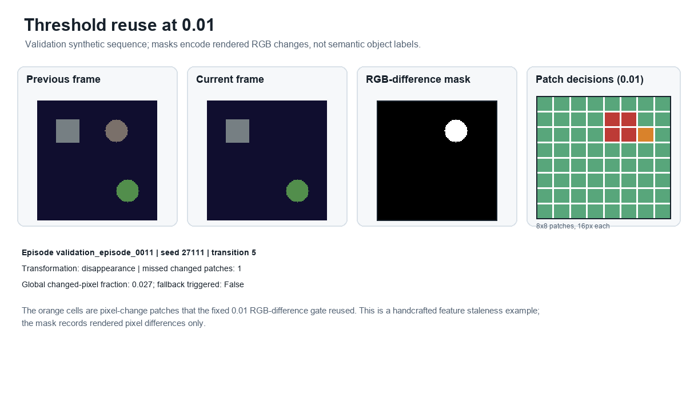
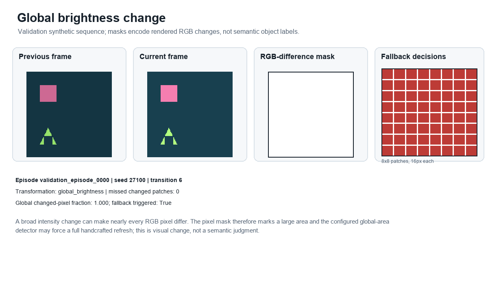
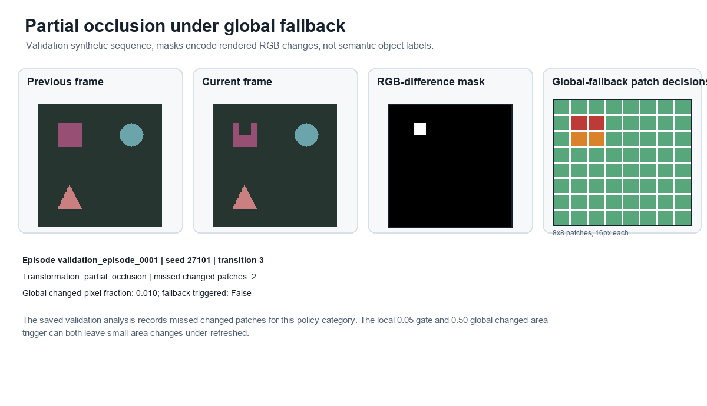
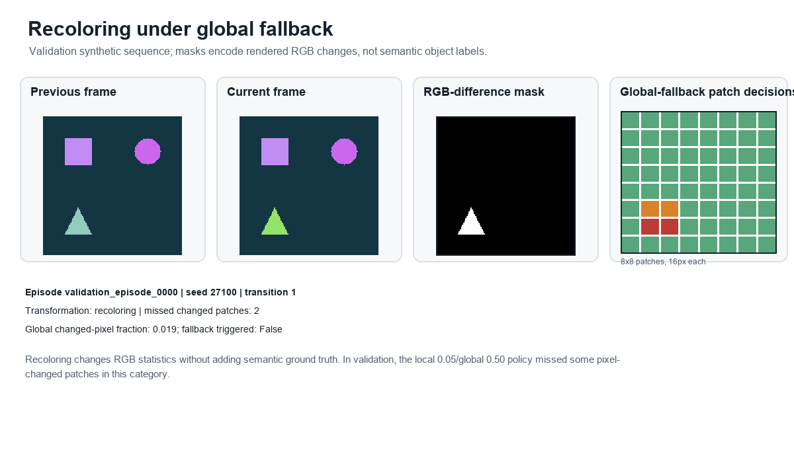
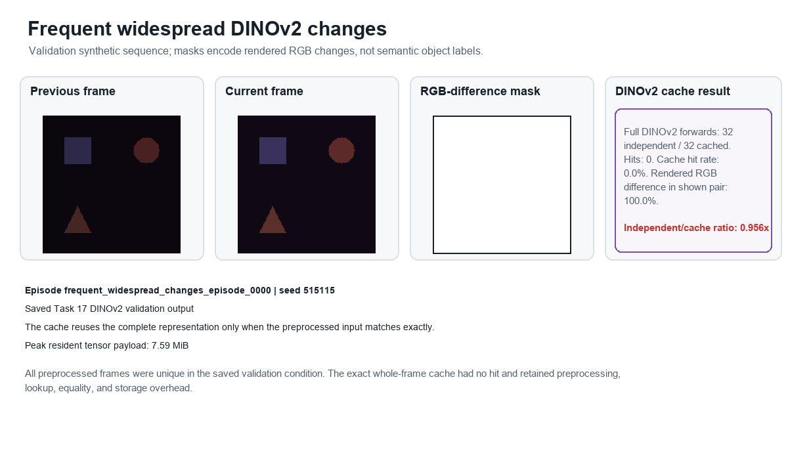
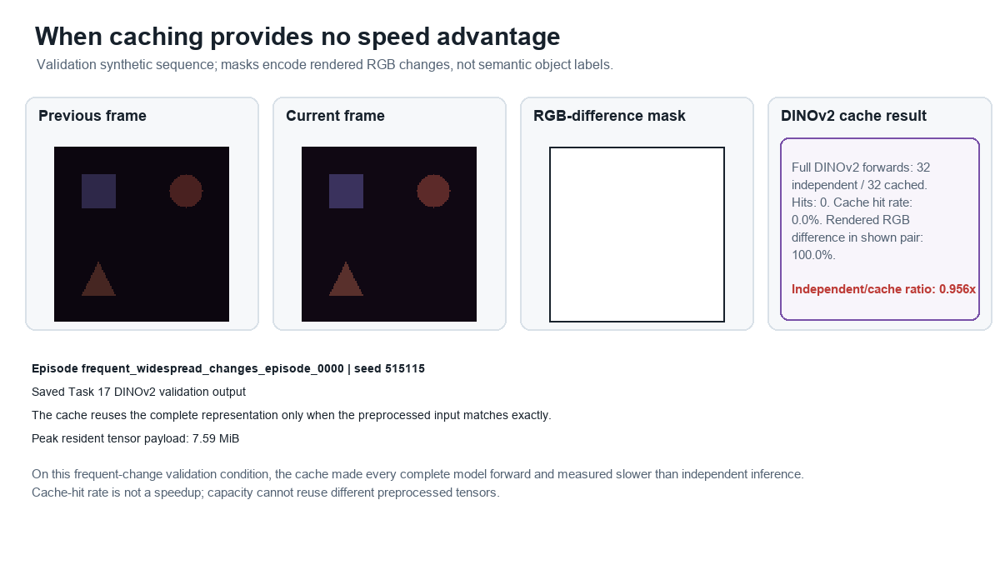

# DeltaVision synthetic validation failure gallery

These deterministic examples come from the synthetic validation manifests. Masks show rendered RGB changes, not semantic annotations. The aggregate held-out RGB results are reported separately and the held-out partition is known to have been inspected in earlier work.

## Approximate Small Change Miss

The orange cells are pixel-change patches that the fixed 0.01 RGB-difference gate reused. This is a handcrafted feature staleness example; the mask records rendered pixel differences only.

Source: validation episode `validation_episode_0011`, seed `27111`, transition `5` (disappearance).

## Global Brightness Shift

A broad intensity change can make nearly every RGB pixel differ. The pixel mask therefore marks a large area and the configured global-area detector may force a full handcrafted refresh; this is visual change, not a semantic judgment.

Source: validation episode `validation_episode_0000`, seed `27100`, transition `6` (global_brightness).

## Partial Occlusion Global Fallback Miss

The saved validation analysis records missed changed patches for this policy category. The local 0.05 gate and 0.50 global changed-area trigger can both leave small-area changes under-refreshed.

Source: validation episode `validation_episode_0001`, seed `27101`, transition `3` (partial_occlusion).

## Recoloring Global Fallback Miss

Recoloring changes RGB statistics without adding semantic ground truth. In validation, the local 0.05/global 0.50 policy missed some pixel-changed patches in this category.

Source: validation episode `validation_episode_0000`, seed `27100`, transition `1` (recoloring).

## Frequent Widespread Changes

All preprocessed frames were unique in the saved validation condition. The exact whole-frame cache had no hit and retained preprocessing, lookup, equality, and storage overhead.

Source: validation episode `frequent_widespread_changes_episode_0000`, seed `515115`, transition `0` (global_brightness_sweep).

## Cache No Speed Advantage

On this frequent-change validation condition, the cache made every complete model forward and measured slower than independent inference. Cache-hit rate is not a speedup; capacity cannot reuse different preprocessed tensors.

Source: validation episode `frequent_widespread_changes_episode_0000`, seed `515115`, transition `0` (global_brightness_sweep).
